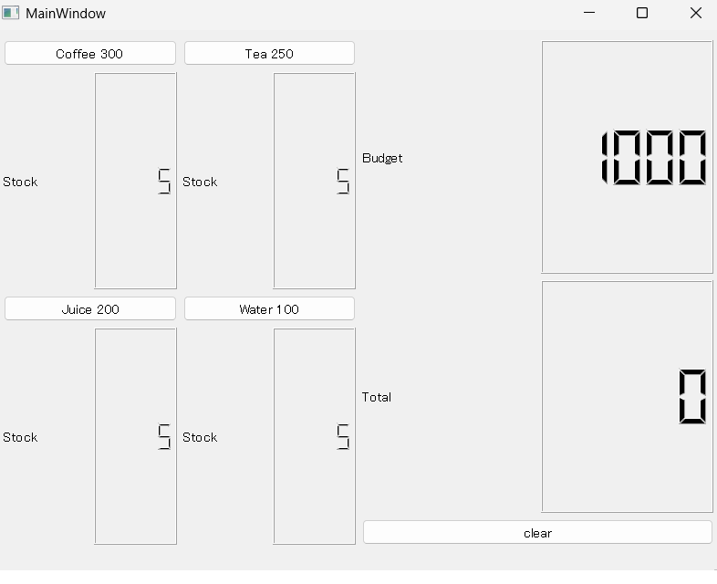
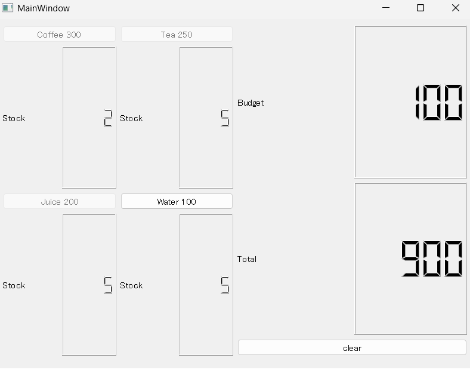

# task2b_cafe_order

## 概要

C++/Qtの学習中に、Claude Codeに作成してもらった追加課題。

- Qt 5.15.2（MinGW 8.1.0 64-bit）
- Qt Creator 20.0.2
- ビルドシステム：qmake（.pro）
- OS：Windows 11

## 仕様

### 画面(初期状態)

- 1. 4種類のドリンクのボタンが 2×2 に並ぶ。ボタンには、ドリンクの名前と値段が書かれている
- 2. それぞれのボタンの下に、残りの数（Stock）が表示されている。最初は 5
- 3. 右側に、残りの予算（Budget）が表示されている。最初は 1000
- 4. 右側に、注文の合計金額（Total）が表示されている。最初は 0
- 5. 右下に clear ボタンがある



### 操作

- ドリンクのボタンを押すと
  - そのドリンクの残りの数が 1 減る
  - 残りの予算から、そのドリンクの値段が引かれる
- ドリンクのボタンは、次のどちらかに当てはまるとき、押せない（非活性）
  - そのドリンクの残りの数が 0
  - そのドリンクの値段が、残りの予算より高い
- `clear`を押すと、すべてが初期状態に戻る

### 動作例

| 手順 | 操作            | Budget | Total | 押せないボタン                       |
| ---- | --------------- | ------ | ----- | ------------------------------------ |
| 0    | 起動            | 1000   | 0     | なし                                 |
| 1    | Coffeeを3回押す | 100    | 900   | Coffee・Tea・Juice(値段が100より高い |
| 2    | Waterを1回押す  | 0      | 1000  | すべて                               |
| 3    | clearを押す     | 1000   | 0     | なし                                 |

手順1の状態:



---

## 設計めも

- `MainWindow`クラス: 画面の管理を行う
- `CafeOrder`クラス: ドリンクの状態管理を行う
- 独自シグナルで画面を更新

---

## 作業メモ

- 開始: 2026/11/4 ～ 終了: 11/10
- 所要時間: 12時間程

## 詰まったところ・質問したこと

- Drinkの価格・在庫・予算・合計の情報をどのように持つのか(質問)
- 画面の初期値の持ち方(質問)
- QMapのループの方法(質問)
- ドリンクとボタンの対応表の作り方(QMapが思うように扱えない)(質問)
- connectの書き方(質問)
- ボタンが押された時の処理の流れ(どのクラスにどんなスロットを置くのか)(質問)
- どのボタンが押されたのかを判断する方法(`sender()`と`qobject_cast<QPushButton *>`)(質問)
- クラスでの定数の書き方(忘れた)(質問)

## 課題2との違いで考えたこと・反省点

ドリンクごとの価格・在庫・予算・合計をどのクラスでどのように管理するかが、ざっくりとしたイメージしかできず、自分の力で対応表の作成や設計をすることがほとんどできなかった。

先生に当初から言われていたが、ボタンが押せるかの状態確認をどのタイミングでする必要があるかは課題2にはない考えるべきことだった。

詰まったところ・質問したことに書いたことは、どれもこれまでやってきたことだが書き方などを忘れている部分が多く、いかにまだ自分の技術となっていないかを痛感した。

今回は公式レファレンスのみの参照OKルールだが、まだまだ公式レファレンスから必要な情報を手に入れる技術もない。

全体的にほぼ答えを教えてもらうに近い質問を多数行い、実装はできたが基本的な知識のなさを再度強く感じた。

今後次のステップに進むべきか、もう少し同じ内容を繰り返して慣れてから次に進むべきか不安。

全体的な総括として、知識・技術があまりにも不十分。

---

## コードを書いた順番

- MainWindow, CafeOrderの対応表(メンバ変数を作る)
- 画面の初期状態(商品のボタン)を完成させる
- ボタンが押された時の処理の一連の流れをテストする(connect)
- CafeOrderの`order()` -> 画面更新
- 初期画面の処理(予算・合計・在庫)
- 予算更新時に各ボタンが押せるかの確認処理
- クリアーボタンの処理
- 画面の初期化処理見直し(`clear()`を使う)

---

## 復習めも

- `struct`
- `qobject_cast`
- `sender()`
- `QMap`: `[]`と`value()`の使い分け

---

## MainWindowクラス

### メンバ変数

- `CafeOrder *m_cafeOrder`: 注文状況そのもの
- `QMap<QString QPushButton *> m_drinkButtons`: 商品名とどのボタンかの対応表  
- `QMap<QString QLCDNumber *> m_drinkStockDisplay`: 商品名とどのLCD(在庫)表示かの対応表

### スロット

- `onDrinkClicked()`: ボタンのクリックを受取り、対応表からどのドリンクかを決め、ロジック側に更新を依頼

---

## CafeOrderクラス

### メンバ変数

- `QMap<QString, int> m_drinkPrices`: ドリンクと価格の対応表
- `QMap<QString, int> m_drinkStocks`: ドリンクの在庫数
- `int m_budget`: 予算
- `int m_total`: 合計

### 関数(public)

- `canOrder(const QString &drink)`: 指定されたドリンクがオーダーできるか

### スロット

- `order(const QString &drink)`: ドリンクの注文(在庫・予算・合計更新 -> シグナル発信)
- `clear()`: 各ドリンク・予算・合計の初期化 -> シグナル送信

### シグナル

- `stockChanged(const QString &drink, int newStock)`: どのドリンクが何杯になったか
- `budgetChanged(int newBudget)`: 新しい予算
- `totalChanged(int newTotal)`: 新しい合計

---

## 質問1: QMapの中にQListを持てるのか？(11/5)

ドリンク1つの状態を1つのQMapで管理したいと思った。

1つのドリンクに対して、価格・在庫数・ボタンが押せるかの状態を1つのメンバー変数に持たせたい。

イメージ: Coffle => {300, 5, true} / 価格(固定), 在庫数(変動), 押せるか(変動)

しかし、QListは中の型は統一でなければならない(?)から不可能かなと...

「ドリンクと価格」、「ドリンクと在庫」、「ドリンクと押せるかの状態」はそれぞれでメンバー変数を持たなけらばいけないのか。

### 回答

案:
- `struct`で`Drink`という型を作る
- `QMap`で2つの情報を管理する(`m_drinkPrices`と`m_drinkStocks`)

いずれにしても「ボタンが押せるかどうかという状態」は持たない。

=> 残りの数と予算から都度計算する

今回は`QMap`で2つの情報を管理する。(`struct`は作らない)

---

## 質問2: ドリンクの名前と価格は固定でよいのか？(11/5)

ドリンクと価格の初期値はCafeDrinkクラスで定義。

UIのボタンの名前(ドリンク名 + 価格)などは、初期処理でCafeDrinkクラスで定義したものを反映させる形にしたい。

でもどうやればいいのかわからない。

なんとなくのイメージ:

- 1.MainWindowのコンストラクタで画面の初期化処理みたいなメンバー関数を呼ぶ
- 2.その関数でCafeDrinkクラスの初期処理で生成されたドリンクと価格を取得
- 3.取得したドリンクと価格を画面のボタンに反映させる

=> 今はドリンクが4つであることが前提だけどこれでいいのか...

=> 表示される順番をCafeDrinkで作った順番で表示させられるのか...

=> でも固定でボタンを作るとドリンク名や価格を変更したときに画面の修正も必要になってしまう(そもそもこの課題でそこまで考えなくていいのか)

### 回答

今回はドリンクの名前と価格は固定でいい。

どのボタンがどのドリンクかは`MainWindow`の対応表で決める。

### その他

`CafeDrink`クラスの名前だと、「ドリンク一杯」を表すクラスに見えてしまう。

今回は`CafeOrder`クラスに名前を変更する。

---

## 再度設計を考える(11/5 ~) 【質問後のアドバイスを元に考えを回答】

### 1. ロジックのクラスに「何を頼み」「何を知らせてもらうか」

頼むこと(スロット)2つ:
- 情報(在庫・予算・合計)の更新 => `order(const QString &drink)`: 「このドリンクを1杯注文して」
- クリアー(初期値に戻す) => `clear()`

知らせてもらうこと(シグナル)3つ:
- 在庫数 => `stockChanged(const QString &drink, int newStock)`: どのドリンクが何杯になったか
- 予算 => `budgetChanged(const QString &drink, int newBudget)`: 新しい予算
- 合計 => `totalChanged(`const QString &drink, int newTotal`)`: 新しい合計

聞くこと(値を返す関数):
- 商品名 => 不要？
- 価格 => `CafeOrder`から設定するなら必要
- ボタンが押せるかの状態 => `canOrder(drink)`

ロジックのクラスで持つもの:

- ドリンクと価格の情報: `QMap<QString, int> drinkPrices`
- ドリンクと在庫状況: `QMap<QString, int> drinkStocks`

2つの`QMap`をメンバ変数として持つ(Private)。

今回は`Stock`を使用しない。

### 2. 「どのボタンをいつ更新するか」 (一番の考えどころ)

- Coffeeを1杯買うと、「Coffeeの在庫」「予算」「合計」が変わる
- 「予算」が変わると、すべてのボタンの押せる押せないに影響する
- 「そのドリンクを今買えるか」を決めるのはCafeOrderクラスが持つ情報(価格・在庫・予算)が必要

=> MainWindowクラスでは「予算が変わったらCafeOrderクラスへ各ボタンが押せるかの情報を問い合わせる」

=> その結果を受けてボタンの押せる・押せないを切り替える

在庫か0かそうでないかでもボタンが押せる押せないの状況は変化する。

今回の仕様では、予算が変わるタイミングで在庫も必ず更新される。

なので、どちらのシグナルを受け取った場合でも、すべてのボタンが押せるかの確認をすればよい。

=> 予算変更時のシグナルで確認する。(特に明示的な理由は言語化できない)

> 予算はすべてのドリンクの「注文できるか」に関わる値なので、予算が変わったら全部のボタンを見直す、と決めておくとわかりやすい。
> また、今の仕様では在庫が変わるときは必ず予算も変わる（order() と clear()）ので、在庫の変化による見直しも漏れない。
> ただし、将来「予算は変わらずに在庫だけ変わる」機能（たとえば在庫の補充）が増えたら、stockChanged でも見直す必要がある。

### 3. MainWindowの対応表

- ドリンクとボタンの対応表
- ドリンクとLCD(在庫)表示の対応表

### 4. 起動したときの処理

- CafeOrderクラスから商品価格を受取り、ボタンの名前を設定する
- CafeOrderクラスの`clear()`を呼び、在庫数・予算・合計を初期して画面に反映する

---

## 質問3: QMapのループ方法(11/7)

`QMap<QString, int>`のようなものでそれぞれのキーと値をループで取得する方法を忘れた。

ビルドエラーが出たやつ:

```
const QMap<QString, int> drinkPrices = m_cafeOrder->drinkPrices();

for (auto it = drinkPrices.begin(); it < drinkPrices.end(); ++it) {
    qDebug() << drinkPrices.at(it);
}
```

### 回答

- `<`でなく`!=`を使う(イテレーターは大小比較できない)
- `it.key()`, `it.value()`を使う
- リファレンス内のイテレーターの使い方を見る(`iterator`で検索)
- `QMap::const_iterator`や`QMap::iterator`などの他のページも見る

---

## 質問4: ドリンクとボタンの対応表の作り方(11/9)

`mainwindow`にて、ドリンクとボタンの対応表を`cafeorder`の`QMap<QString, int> drinkPrices()`を使って作りたい。

ボタンのobjectNameは`drink1Button ~ drink4Button`。

for文の中で1~4を`int i`で持ち、drinkPrices(QString, int)のkeyを使って対応表を作りたいが、書き方がわからない。

そもそも、このやり方がよいのかもわからない。

### 回答

このやり方はよくない。なぜなら、`QMap`はキーの順番(アルファベット順)に並び替えらる。

=> 「QMap はキーの順番に並び替えるので、書いた順番には頼れない」

どのボタンがどのドリンクかは、画面側が決めるのでロジック側に依存しない。(対応表を固定で作ってしまう)

=> objectNameも1~4のような名前でなく具体的な名称に変更する

---

## 質問5: connectの書き方(スロット・シグナル)とボタンが押された時の処理(11/9)

一旦やろうとしていること:
- ボタンを押す -> order()を呼び出す -> いったんQDebugでconnectできているか確認したい
- connectを`m_drinkButtons`のループで回す(?)

わからないこと:
- connectの第四引数の書き方がウル覚え
- そもそもボタンが押された時に呼び出す関数はMainwindow?CafeOrder?のどちらに定義する?
- ループの中で引数のドリンクを渡すのでなく、受け取った側の処理でボタンから取得(?)書き方を忘れた
- スロットと通常の関数の違いはconnectの中で使用する関数がスロット？？

### 回答

全体の流れを整理(2段階になっている):

- 1. ボタンが押される: QPushButtonのシグナルはどのドリンクは知らない
- 2. MainWindowのスロット(例: onDrinkClicked): 対応表でボタンとドリンクを通訳
- 3. CafeOrderのスロット(例: order(drink)): 実際のドリンクの更新の処理(更新後にシグナルでMainWindowに伝える)

`ボタンクリック` -> `onDrinkClicked` -> `order(drink)`

- `clicked`シグナルは押されたと知らせるだけ(どのドリンクかは知らない)
- `CafeOrder`は画面のことを知らない -> どのボタンが押されたかはわからない

=> なので画面とロジックを両方知っている`MainWindow`が間に入って通訳する

受け取った側の処理で、ボタンからドリンクを取得する書き方:

```
QPushButton *button = qobject_cast<QPushButton *>(sender());   // 押されたボタン
```

=> 書き方を覚えていなかった

---

## 質問6: クラスでの定数の書き方(書き方を忘れた)

- CafeOrderクラスで予算、在庫の初期値をクラス定数で持ちたい
- しかしクラスでの定数の書き方を忘れてしまった

### 回答

例:

```
static constexpr int INITIAL_STOCK = 5; // 各ドリンクの初期在庫数
```

- `static`: オブジェクトごとでなく、クラスに1つある
- `constexpr`: コンパイルするときに値が決まる定数

その他指摘:

`m_drinkStocks[drink]` と `m_drinkPrices[drink]` のように `[]` を使っている。

`[]` は存在しないキーを渡すと追加してしまう。

=> 調べるときなどは、`const`をつけて`value()`を使うと安全

---

## スロットは何か今の知識で言語化してみる

スロットは、connectで例えばボタンが押された時に押させる処理(メンバー関数)という認識。

ヘッダの`public:`で書いてもスロットとして呼び出せるが、古い書き方では不可。

古い書き方対応と明示的にスロットとして定義するという意味で`public slots:`に定義するのがいい。

=> 改めて「スロットとは何か？」を確認(ただの記憶にしない・理解する)

=> 他にも学習し直すことは山ほどあるが...

### 補足

シグナル/スロットの一番の価値は、送る側(ボタンや`CafeOrder`)は、受け取る側が誰で何をするのか知らなくていい。

